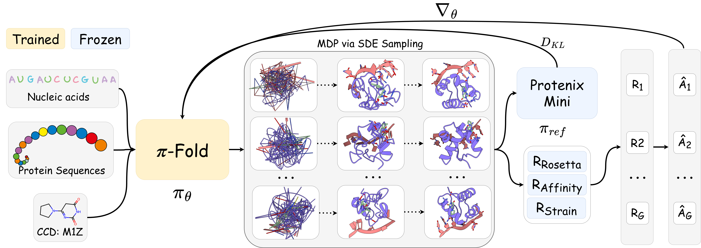

<h1 align="center">
  Plausible Biomolecular Structure Prediction via

  Physics-informed Reinforcement Learning
</h1>


This repository contains the code necessary to reproduce **$\pi$-Fold** introduced in the [NeurIPS 2026 paper](https://openreview.net/forum?id=RM7NMWgQlH):

"Plausible Biomolecular Structure Prediction via Physics-informed Reinforcement Learning"


## Overview

<p align="center">
  
</p>

**$\pi$-Fold** fine-tunes biomolecular co-folding models with GRPO and physics-based rewards (Rosetta energy, Vina affinity, ligand strain) to produce physically plausible structures.


## 🛠 Installation

### Create Conda Environment

We recommend using Python 3.11 in a dedicated Conda environment

Clone this repository and install packages by:

```bash
git clone https://github.com/newturing/pifold.git
cd pifold

conda create -n pifold python=3.11
conda activate pifold
pip install -e .
```

### Set up Pyrosetta
```bash
python -c 'import pyrosetta_installer; pyrosetta_installer.install_pyrosetta()'
```

### Set up Smina
```bash
# We use smina to calculate the binding affinity of the predicted structure.
wget https://sourceforge.net/projects/smina/files/smina.static/download -O smina
chmod +x smina
```

##  RL Training

RL training needs at least 2T of disk space for the training data, and the `PROTENIX_ROOT_DIR` environment variable set to the data directory. See [Preparing the datasets](docs/training_rl.md#1-preparing-the-datasets) for the download steps.

For detailed instructions on training, please refer to the [RL Training Documentation](docs/training_rl.md).

## Model Checkpoint

| Model | Base model | Download |
| :--- | :--- | :--- |
| `pifold` | `protenix_mini_default_v0.5.0` | [pifold.pt](https://huggingface.co/tai-dang11/pifold/resolve/main/pifold.pt) |

Inference downloads the checkpoint automatically on first use. To download it yourself:

```bash
mkdir -p release_data/checkpoint
wget https://huggingface.co/tai-dang11/pifold/resolve/main/pifold.pt -O release_data/checkpoint/pifold.pt
```

## Inference

After `pip install -e .`, the `pifold` command runs structure prediction on a JSON input:

```bash
pifold pred -i examples/input.json -o ./output -n pifold --use_default_params true
```

On first run, inference also downloads the CCD component folders (`ccd_cif/` and `ccd_rdkit_mol/`) from [tai-dang11/pifold_dataset](https://huggingface.co/datasets/tai-dang11/pifold_dataset) into `$PROTENIX_ROOT_DIR`, which defaults to your home directory. See `pifold pred --help` for all options, and [infer_json_format.md](docs/infer_json_format.md) for the input format.

You can also run the demo script:

```bash
bash inference_demo.sh
```

[inference_demo.sh](inference_demo.sh) runs example predictions with `pifold pred` (Section 1), `runner/inference.py` (Section 2) and $\pi$-Fold (Section 3). To run your own checkpoint from RL training in Section 3, set `PIFOLD_CKPT` to a checkpoint saved by `rl.sh`:

```bash
PIFOLD_CKPT=/path/to/checkpoints/{step}_ema_0.999.pt bash inference_demo.sh
```

Key arguments:
* `model_name`: model to use, e.g. `pifold`.
* `load_checkpoint_dir`: directory holding `{model_name}.pt`. Defaults to `release_data/checkpoint/`.
* `input_json_path`: path to a JSON file that fully specifies the input structure.
* `dump_dir`: directory where inference results will be saved.
* `dtype`: data type used during inference. Supported options: `bf16` and `fp32`.
* `use_msa`: whether to enable MSA features (default: true).


> **Note**: By default, layernorm and EvoformerAttention kernels are disabled for simplicity.
> To enable them and speed up inference, see the [**Kernels Setup Guide**](docs/kernels.md).


## Training and Inference Cost

For details on memory usage and runtime during training and inference, refer to the "Training and Inference Cost" section in [training_inference_instructions.md](docs/training_inference_instructions.md#-training-and-inference-cost).


## Acknowledgements

$\pi$-Fold is built on [Protenix](https://github.com/bytedance/Protenix), a trainable reproduction of AlphaFold 3 by ByteDance. The model architecture, data pipeline and base checkpoints come from Protenix. We also use [PyRosetta](https://www.pyrosetta.org/) for Rosetta energy scoring.


## Citing this work
```bibtex
@inproceedings{
  dang2026plausible,
  title={Plausible Biomolecular Structure Prediction via Physics-informed Reinforcement Learning},
  author={Tai Dang and Hieu Tran and Long-Hung Pham and Sang T. Truong and Edward A Pham and Jeffrey S. Glenn and Thang Luong},
  booktitle={The Fortieth Annual Conference on Neural Information Processing Systems},
  year={2026},
  url={https://openreview.net/forum?id=RM7NMWgQlH}
}
```
